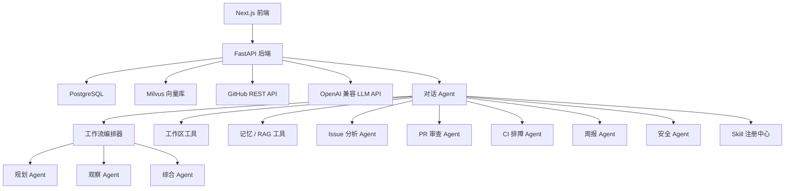

# RepoLens AI

RepoLens AI 是一个面向 GitHub PR / Issue 研发协作的全栈 AI Agent 项目。系统会连接仓库数据，分析 Issue、PR diff、CI 日志、项目知识库和本地工作区代码，并返回结构化建议与安全的操作草稿。

## 核心能力

- 连接并同步 GitHub 仓库中的 Issue、Pull Request、PR 文件、Review 评论、Workflow Run、Job 和日志。
- Issue 分析：分类、优先级、复杂度、推荐负责人、重复候选和行动项。
- PR 审查：摘要、关键变更、风险点、检查清单、测试建议和需要重点关注的文件。
- CI 排障：失败类型、可能原因、排查步骤和相关上下文。
- Agent 对话：`ChatAgent` 使用原生工具调用，串联工作区、记忆、RAG、Issue、PR、CI、周报和安全工具。
- 多 Agent 工作流审查：`WorkflowOrchestrator` 构建 Planner -> 专用 Agent -> Observer -> Synthesis 的闭环，用于 PR 就绪度、阻塞项、优先级和跨领域工程决策。
- Skill Runtime：按用户显式指定或触发条件选择 `SKILL.md`，只向当前任务加载完整指令与受限资源；显式 Skill 校验允许工具，多 Agent 中的专用 Agent 分别加载自己的 Skill，并把版本、激活原因、指令摘要和执行校验写入 trace。
- 工作区代码工具：安全地列出文件、读取文件和搜索本地代码。
- RAG 聚焦 Issue 描述、PR 说明与 Review 评论、失败 CI 日志、项目文档、上传知识和已批准的长期记忆；当前代码走工作区/词法检索，团队与实时状态走结构化查询。
- 生成工程周报。
- 基础 Eval 覆盖 Issue 分类、PR 覆盖度、RAG 命中率、工具 schema 就绪度和结构化输出校验。

从导航栏打开「Repos」，在对应仓库卡片中选择「负责人推荐」，可维护未分配 Issue 的候选成员。

## 技术栈

- 后端：Python、FastAPI、Pydantic、SQLAlchemy、PostgreSQL、Milvus、httpx、LangChain。
- Agent 编排：原生工具调用 + 专用分析 Agent。
- 前端：Next.js、TypeScript、Tailwind CSS、React Query。
- 基础设施：Docker Compose 与 `.env` 配置。

## 架构



## 快速开始

```bash
cp .env.example .env
docker compose up -d postgres etcd minio milvus

cd backend
python -m venv .venv
.venv\Scripts\activate
pip install -r requirements.txt
uvicorn app.main:app --reload
```

另开一个终端：

```bash
cd frontend
npm install
npm run dev
```

默认地址：

- 后端：http://localhost:8000
- API 文档：http://localhost:8000/docs
- 前端：http://localhost:3000

### Windows 一键启动前后端

安装上述 Python、前端依赖并配置根目录 `.env` 后，在 PowerShell 7.4 或更高版本执行：

```powershell
.\scripts\start_rag.ps1
```

脚本正常启动 FastAPI 和 Next.js，遵循后端 `.env` 配置，不会禁用 Milvus、LLM、RAGAS 或自动同步，也不会切换 SQLite、写入演示数据或修改知识库阈值。使用本地 Qwen Embedding 时仍需安装 `backend/requirements-local-embedding.txt`。运行环境变量和 `backend/.env` 的优先级遵循后端设置；旧脚本遗留的整套演示环境变量会在后端子进程中清除。

如果还需要启动本项目 Docker Compose 中的 PostgreSQL、etcd、MinIO 和 Milvus，先打开 Docker Desktop，然后执行：

```powershell
.\scripts\start_rag.ps1 -StartInfrastructure
```

也可用 `-BackendPort 8001 -FrontendPort 3001` 自定义端口，前端 API 地址会同步更新。端口已占用时脚本会报错退出，不会把已有服务误认为新启动的服务。日志保存在 `.data/repolens-*.log`，停止前后端使用：

```powershell
.\scripts\stop_rag.ps1
```

停止脚本会校验进程启动时间并结束整个进程树，重复执行也不会报找不到 PID；Docker 基础设施保持运行。如果终端已经位于 `scripts` 目录，使用 `.\start_rag.ps1` 和 `.\stop_rag.ps1`。

## Python 开发检查

Python 源码和测试遵循根目录 `AGENTS.md` 中的 PEP 8 约定。安装开发依赖后，在项目根目录检查格式和导入顺序：

```powershell
.\backend\.venv\Scripts\python.exe -m pip install -r backend/requirements-dev.txt
.\backend\.venv\Scripts\python.exe -m ruff check backend/app scripts
.\backend\.venv\Scripts\python.exe -m ruff format --check --output-format concise backend/app scripts
```

自动整理使用 `ruff check --fix` 和 `ruff format`。格式规则由根目录 `pyproject.toml` 管理，CI 会执行同样的检查。

## 模型上下文窗口

`CONTEXT_DYNAMIC_MODEL_WINDOW_ENABLED=true` 时，系统按 `LLM_MODEL` 识别模型窗口，`CONTEXT_MAX_INPUT_TOKENS` 作为未知模型的回退预算。`deepseek-flash`、兼容别名 `deepseek-v4-flash` 与 `deepseek-v4-pro` 按 DeepSeek `/models` 元数据使用 **1,048,576 tokens** 的总窗口；`CONTEXT_MODEL_WINDOW_TOKENS=0` 表示自动识别，也可为自定义接口设置明确的窗口上限。

总窗口包括输入和输出。当前配置为正式压缩预留 12,000 tokens，诊断中的有效窗口为 **1,036,576 tokens**；最近历史按预算比例分配，默认约 **230k tokens**，不是固定 6k。窗口有空间时保留完整消息，按预算读取最多 500 条活跃历史；超出预算或压缩边界以前的原文仍通过历史工具回查。配置变化在重启后生效，已有消息保存的历史诊断不会被重写。

## RAG 知识问答系统

从「项目知识」选择仓库后，可在详情页上传和管理文档、测试召回、调整设置，以及在「知识问答」中查看带引用的回答。旧 `/rag` 地址会打开项目列表，选中项目后直接进入知识问答。

项目内置了与第 7.1 节流程一一对应的完整 RAG 系统：知识库创建向导、文档解析、段落感知切片、Embedding、向量/关键词混合检索、重排、召回测试、问答工作室、上下文组装、基于证据生成和编号引用。支持 TXT、Markdown、PDF、DOCX、JSON、CSV 与日志文件；重复文件会按 SHA-256 跳过。

对话链路采用混合 RAG：`ContextAssembler` 会在调用 ChatAgent 前按原始问题检索并注入证据；进入推理循环后，模型仍可把 `rag.search_similar_documents` 当作工具，改写查询、连续补查不同资料，并根据多次工具结果交叉验证答案。

项目不会把所有私域数据都向量化。只有需要跨来源语义召回、会反复使用的非结构化知识进入 RAG；源码与配置以当前 checkout 为准，优先通过 `workspace.search_code` 和 `workspace.read_file` 检索；Issue、PR、CI 的状态字段、团队成员和周报等结构化或派生数据直接查数据库/API。RAG 返回的是候选证据，涉及实时状态和当前代码时仍要回到权威数据源核验。

从旧版本升级后，请对每个知识库调用一次 `POST /api/rag/{repo_id}/reindex`。重建会按新边界清理历史向量和旧会话 Document；只部署代码不会主动删除已有索引。

Windows 可使用上面的“一键启动前后端”脚本，按 `.env` 配置运行完整服务。向量召回、混合检索和重建索引需要 PostgreSQL、etcd、MinIO 和 Milvus 正常运行。

知识库默认选择 `Qwen/Qwen3-Embedding-0.6B` 与 `qwen3-rerank`。安装 `backend/requirements-local-embedding.txt` 后可运行本地 Qwen Embedding；配置 `DASHSCOPE_API_KEY`、`RERANK_BASE_URL` 后可切换百炼 `text-embedding-v4` 与 `qwen3-rerank`。默认 Embedding 依赖缺失时系统会明确报错，不会静默改用另一套向量空间。启动脚本默认使用已配置的 `LLM_API_KEY`，无需再传 `-UseConfiguredLLM`（该参数保留兼容旧命令）。

本地 Embedding 模型默认缓存到项目根目录下的 `.data/huggingface/hub`，可通过 `LOCAL_EMBEDDING_CACHE_DIR` 指定其他可读写目录。完整下载模型后，可设置 `LOCAL_EMBEDDING_LOCAL_FILES_ONLY=true` 离线加载，避免问答时访问 Hugging Face。模型依赖缺失、下载不完整或缓存权限不足时，API 返回带有具体提示的 503 响应，页面会显示请求失败原因。

CPU 推理使用 float32 和小批次，避免 Qwen 默认 bfloat16 或大批次填充在部分 CPU 上运行缓慢。重建索引在工作线程执行，健康检查和其他请求仍可响应。询问“这个项目是干什么的”等项目概览问题时，本地召回会结合当前选择的仓库名称，重排及生成保留用户原问题；回答仍须通过证据分数门槛。

新知识库的默认分数门槛为 `0.5`，可在知识库检索设置中调整。门槛应结合当前检索及重排模型的实际分数设置；例如相关性分数为 `0.57` 的资料会被 `0.8` 门槛过滤。全部候选被过滤时，回答会明确显示候选数量、最高分和当前门槛，而非笼统提示资料不足。已有知识库保留各自配置。

仓库实时事实不从历史文档推测：询问“最近一次 commit 是什么时候”等问题时，直接读取所选仓库本地 checkout 的 Git HEAD，返回提交时间（北京时间）、分支、哈希、作者及来源，并明确本地查询范围；不会自动拉取远端。文档冲突检查仅比较与问题相关、同一陈述和相同分支/版本范围的相反结论，避免把不同功能的“允许/禁止”“成功/失败”混判为冲突。

RAG API：

```text
POST /api/rag/knowledge-bases
GET  /api/rag/knowledge-bases
GET  /api/rag/knowledge-bases/{repo_id}
POST /api/rag/knowledge-bases/{repo_id}/documents
POST /api/rag/knowledge-bases/{repo_id}/retrieval-tests
GET  /api/rag/{repo_id}/status
POST /api/rag/{repo_id}/search
POST /api/rag/{repo_id}/ask
POST /api/rag/{repo_id}/reindex
```

## ChatAgent RAGAS 评测

启动主应用后，从导航栏打开「RAG 评测」或访问 `http://127.0.0.1:3000/evals`。选择仓库、固定评测集和 Top-K，再点击「运行评测」。评测会在隔离会话中真实运行生产 ChatAgent 和工具集，收集预检索与 Agent 二次检索证据，然后使用 Ragas 0.4 Collections API 计算 Context Precision、Context Recall、Faithfulness、Answer Relevancy 和 Agent Goal Accuracy。结果会保存评测集 Hash、阈值、逐题工具轨迹、检索证据、硬规则与失败诊断，便于对同一基线做回归。

默认 Judge 复用 `LLM_API_KEY`、`LLM_BASE_URL` 和 `LLM_MODEL`。可通过 `.env` 中的 `RAGAS_JUDGE_API_KEY`、`RAGAS_JUDGE_BASE_URL`、`RAGAS_JUDGE_MODEL` 单独配置。固定评测集位于 `docs/datas/evals/`，运行前会检查预期文档是否已在所选仓库完成索引。

要运行「知识库问答」评测集，先在「项目知识」上传 `docs/examples/rag_chapter_07/` 中的五份资料，再从「RAG 评测」页选择同一个仓库和该评测集。它有 9 道固定题。跨文档题要求命中全部预期来源，冲突题检查新旧阈值，拒答题仅计入硬规则。页面支持分别运行 Top-K 2、3、4 并查看各次结果。

通过 API 提交时可使用以下请求。

```http
POST /api/evals/rag/run
Content-Type: application/json

{
  "repo_id": "<repository-uuid>",
  "run_judge": true,
  "top_k": 3,
  "suite_id": "chapter-07-quality-gate"
}
```

提交接口会立即返回 `queued` 状态和 `eval_id`，ChatAgent 与 RAGAS 在后台继续运行。通过 `GET /api/evals/{eval_id}` 轮询 `result.progress`；状态变为 `passed`、`failed`、`error` 或 `no_cases` 时结束。网页会自动轮询，刷新或离开页面不会中断已经提交的任务。

整体通过要求硬规则全部满足，并且五项语义指标都达到 `.env` 中对应的 `RAGAS_*_MIN` 门槛。页面把“执行状态”和“质量状态”分开显示：低分是质量失败；Judge 调用失败或指标缺失是评测不完整，不能伪装成质量结论。

评测失败后可以直接在同一页面继续处理：

- 展开 Case 查看实际回答、参考答案、检索来源、工具轨迹和可执行诊断；
- 对 Judge 超时或缺失指标点击“仅重试异常评分”，复用已经保存的回答和证据，不重新运行 ChatAgent；
- 选择两个相同评测集 Hash、Ragas/Judge 配置和 Top-K 的结果做回归对比；
- 生成 `create_issue` 类型的 ActionDraft，把失败 Case、证据和建议带入人工确认流程，不会直接写入 GitHub。

### GitHub Actions

- **Backend CI** 在 PR 更新和推送到 `main` 时跑后端 Pytest，使用 SQLite、确定性 embedding 和测试替身。
- **RAGAS Eval** 在 Actions 页面手动运行。将 DeepSeek Key 配为仓库 Secret `LLM_API_KEY`。评测使用仓库内的员工手册固定用例、Qwen Embedding、Milvus 和 DeepSeek Judge。运行摘要显示门禁状态和分数，`ragas-eval` 产物包含逐题证据、工具轨迹和诊断。对比两轮结果时可检查评测集和手册的 SHA-256。
