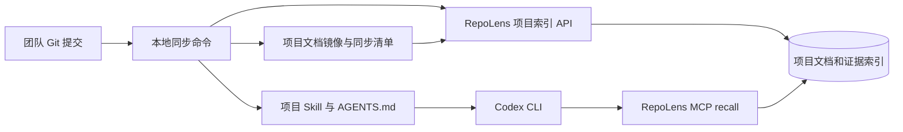

# 团队仓库资源同步技术架构

状态：V1.0 评审稿。产品行为见 [PRD](PRD.md)，版本边界见 [ROADMAP](ROADMAP.md)，关键取舍见 [ADR](ADR.md)。

## 系统边界

本地同步命令从团队 Git 仓库读取确定的提交，把资源投递到一个目标工作区。Codex CLI 从目标项目读取 Skill、规则和指令。文档镜像由同一台机器上的 RepoLens 后端索引，Codex 通过已配置的本地 RepoLens MCP 调用 `recall`。

同步命令以用户明确选择的源仓库和目标项目为输入。RepoLens 通过 `GET /api/repos` 的 `local_path` 将目标工作区绑定到唯一 `repo_id`。CLI 和后端都需要能访问同一个目标根目录。目标尚未连接或路径无法唯一匹配时，文档索引显示待处理，项目上下文文件仍可按已确认的预览交付。 [仓库列表](../../backend/app/api/routes/repos.py) · [仓库响应](../../backend/app/schemas/repos.py)

## 来源读取与投递

本地命令在预览开始时解析一次源仓库 `HEAD`。通过 Git tree 列出约定目录，再按 blob 对象 ID 取内容。先完整读取并校验来源，再生成变更计划。计划包含来源 SHA、目标项目、各项操作和目标当前摘要。用户确认后按这份计划应用，源分支后续移动不改变本次输入。

| 来源 | 目标 | 实现约定 |
| --- | --- | --- |
| `skills/<name>/SKILL.md` 及文本参考资料 | `.agents/skills/<name>/` | 按相对路径保留目录结构。入口及参考资料一起校验，交付和冲突检测按文件记录。 |
| `rules/<name>.md` | 项目根 `AGENTS.md` 的团队管理区块 | 按源路径排序，生成规则小节。带 `paths:` 的新版显示待支持。若该规则之前按项目级交付，预览同时列出旧条目的撤下。 |
| `agentsmd/*.md` | 同一区块的共享指令小节 | 按源路径排序拼接。通过一对稳定标记定位整个区块，保留区块以外的原始内容。 |
| `docs/` 下的 Markdown | `sharing.docs.localDir`，首版默认 `<目标项目>/docs/team-shared/` | 保留相对目录结构，例如 `docs/runbooks/release.md` 镜像为 `docs/team-shared/runbooks/release.md`。清单同时记录原始路径与镜像路径。 |

来源读取限于受支持的文本文件和普通 Git blob。路径校验覆盖目录越界、符号链接或目录联接、Windows 路径歧义与大小写冲突。应用前再次确认目标仍落在用户选定的项目内。同步命令交付文本和文件，Codex 的工具权限沿用其自身配置。 [Codex 项目指令与 Skill 路径](ROADMAP.md)

## 本地状态、应用与恢复

使用目标项目 `.repolens/team-resource-sync/` 保存清单和恢复所需的临时数据。清单带版本号，记录源仓库绑定、本次确认的提交、每项受管理的目标相对路径及最后写入摘要。`AGENTS.md` 仅登记管理区块的摘要。文档额外记录原始相对路径、该版本的来源提交和内容摘要。相同路径与内容沿用原有文档版本来源，团队仓库的无关提交无需触发文档重建。

1. **生成计划。** 比较预期产物、上一次清单和目标当前内容。目标存在未登记同名文件、已登记内容与上次写入摘要不符、管理块标记损坏或预览后目标走样时，标记冲突并停止文件应用。资源移除以完整来源中的确切缺失或预览中明确列出的规则范围变更为依据。Git 对象读取不完整时报告错误并停止应用。
2. **应用文件。** 在目标项目取得排他锁，重查目标摘要。先暂存待写文件和恢复清单，在同一文件系统逐个替换目标文件。以写入新清单作为文件阶段提交点。正常结束时清理临时数据。
3. **恢复中断。** 有未完成的恢复清单时先核对本次写入与实际内容。可以识别的未完成写入恢复到上次状态，已完成的应用清理临时数据。发现用户又修改了文件时报告冲突，由成员处理。
4. **更新索引。** 文件阶段完成后释放锁，再触发文档索引。索引失败或等待超时的结果单独显示为「文件已同步，文档索引待重试」。再次同步同一提交可补做索引。

正在应用文件时，索引服务以未完成清单识别过渡状态。正常索引的提交以完整文档快照为单位。相同项目的扫描提交按项目串行，并在提交前再次核对文档清单版本。

## 复用项目索引与 `recall`

### 触发与确认索引

- 使用现有 `POST /api/repos/{repo_id}/memory-index/scan` 和 `GET /api/repos/{repo_id}/memory-index/state`。`202` 表示扫描已受理。CLI 等待状态完成并比对已索引的团队文档清单摘要，避免把早前一次 `ready` 当成本次同步结果。摘要可放入现有 `summary_json`。
- `scan_project_index` 根据本地镜像和清单建立索引。沿用项目文档发现规则，核对清单中待索引的文档是否被项目 allowlist、扫描上限或读取错误排除。被排除时，在索引状态中提供受影响路径和原因。
- 在索引事务里把 `team_source_path` 和对应的 `team_source_commit` 写入文档元数据，并沿现有流程刷新证据索引。只有镜像内容摘要与清单匹配时才附加团队来源。撤下文档后，现有项目文档替换流程清除对应检索记录。 [项目索引 API](../../backend/app/api/routes/project_index.py) · [项目索引实现](../../backend/app/services/project_indexing.py)

### 检索和来源返回

在现有 RepoLens stdio MCP 中增加只读 `recall` 工具。试点一次性接入本地 MCP 服务并绑定目标项目。工具要求显式传入 `repo_id` 和查询词，核对仓库与这一绑定一致，再按团队文档过滤、排序和截取结果。每条返回 `title`、`snippet`、`source_path` 和 `source_commit`。`source_path` 使用索引中保存的团队仓库相对路径，同一条结果的内容和来源来自同一次索引提交。索引待重试期间，仍可查询上一次成功索引的文档，来源提交反映实际检索到的版本。

PoC 已验证底层检索结果保留文档路径。现有 `repolens_search_evidence` 在 MCP 层投影为文本时省略了该字段。新增 `recall` 可继续复用底层检索，按自己的返回契约将来源传给 Codex。 [现有检索](../../backend/app/services/chat_memory.py) · [现有 MCP 输出](../../backend/app/mcp/memory_server.py) · [Codex 本地 MCP 接入](https://learn.chatgpt.com/docs/extend/mcp?surface=cli#supported-mcp-features)

## 验证重点

| 验证面 | 工程验收 |
| --- | --- |
| Git 快照 | 预览后移动源 `HEAD`，应用仍来自原提交。未提交内容与不可读对象的处理符合预览结果。 |
| 托管文件 | 在 Windows 验证同名冲突、预览后修改、`AGENTS.md` 管理区块外内容、更新、撤下、重复运行与中断恢复。 |
| 文档与溯源 | 验证嵌套源路径、不同名称的镜像目录、文档替换和撤下、串行索引提交，以及 `recall` 返回的原始路径和来源提交。 |
| 实际使用 | 先检查 Codex 的 Skill 发现和项目指令加载，再用实际 Codex CLI 会话完成一次 PR 审查，并通过 `recall` 引用文档。 |

PoC 已跑通四类文件交付、Codex 原生上下文加载和现有文档检索，并通过 20 项定向回归。正式实现仍需验证恢复清单、索引状态关联、`recall` 返回契约和真实 PR 的模型执行。
